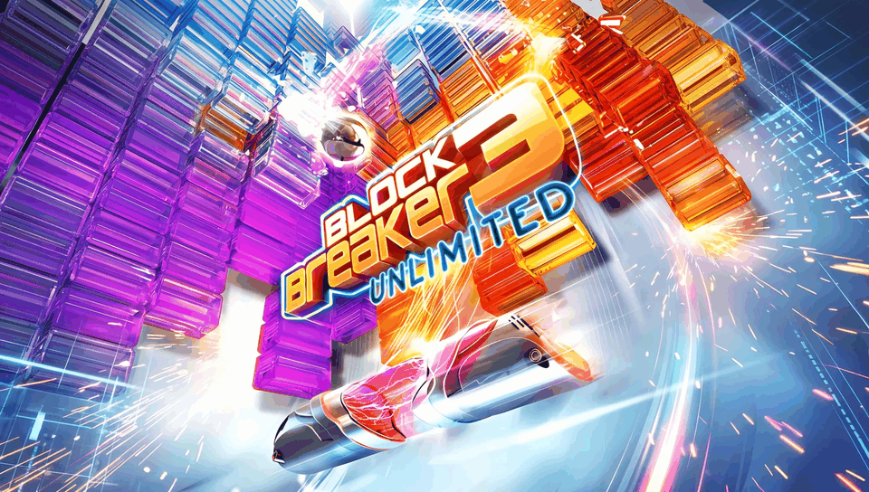

<h1 align="center">
  <br>
  Block Breaker 3 Unlimited · PS Vita Port
</h1>

<p align="center">
  <b>Native port of Block Breaker 3 Unlimited (Gameloft) for PlayStation Vita and PlayStation TV.</b>
</p>

<p align="center">
  
  
  
  
  
  
</p>

<p align="center">
  <a href="#-description">Description</a> •
  <a href="#-features">Features</a> •
  <a href="#-controls">Controls</a> •
  <a href="#-installation">Installation</a> •
  <a href="#-known-issues">Known Issues</a> •
  <a href="#-building-from-source">Build</a> •
  <a href="#-credits">Credits</a>
</p>

---

## 📖 Description

An unofficial, native **iOS-to-PS Vita wrapper port** of *Block Breaker 3 Unlimited* (originally developed by **Gameloft**). There is no `.so` here: this port ships its own **Mach-O loader** that maps the official iOS ARM executable (`BBD3`, from the 1.6.0 IPA) into PS Vita RAM and replaces the Apple frameworks it uses (Foundation, UIKit, CoreAudio, OpenGL ES) with native implementations on top of **vitaGL**, **zlib** and the Vita system libraries. The executable is stripped, so every hook is placed by address.

---

## 🎮 Status & Playability

**Status: Playable (v1.0)** — the game boots, reaches the menus, the world map and the levels, and is
fully playable on physical PlayStation Vita hardware. Progress and history: [`port_progress.md`](port_progress.md)
and [`RELEASE.md`](RELEASE.md).

- [x] **Mach-O loader**: loads the iOS ARM executable at a fixed base (`MACHO_SLIDE = 0x98000000`), applies **48,923** rebase words, resolves **8,063** import slots, runs the **314** global constructors and enters the main game loop. *Verified on console.*
- [x] **Graphics**: GLES 1.x → **vitaGL** (compiled with `SOFTFP_ABI=1`). The game renders into its 320×480 portrait framebuffer, which is presented on the Vita's 960×544 screen in one of four display modes (see [Display Modes](#display-modes--limitations)). *Verified on console.*
- [x] **Textures**: the engine's statically linked libpng 1.2 uses its own zlib, which fails on the Vita; its `inflate*` entry points are redirected to the host zlib, so every PNG texture decodes correctly. *Verified on console.*
- [x] **Touch & Controls**: the front touchscreen provides full touch input, mapped to the active display mode. The left stick and D-Pad move the paddle; face buttons launch the ball. *Verified on console.*
- [x] **Audio**: AudioUnit (RemoteIO) is emulated on a dedicated `sceAudioOut` thread; music (`.it` modules) and sound effects play. *Verified on console.*
- [x] **Saves**: progress is written to `ux0:data/blockbreaker3unlimited/saves/` (`bbd3.sav`, `profile.sav`) and loaded on boot (iOS 64-bit-inode `stat` layout emulated).
- [ ] **Performance**: CPU at 444 MHz, buffered logger (no SD writes during gameplay), cached lookups for missing bundle files, `-mcpu=cortex-a9 -mfpu=neon`. Targets 60 FPS; sustained 60 FPS after the latest changes still has to be confirmed on hardware.
- [x] **Offline bypasses**: in-game ads, App Store and network calls are gracefully stubbed.

### 📋 Changelog (v1.0)

- **Loader**: fixed-base mapping at `0x98000000`; 48,923 rebase words applied; 8,063 import slots resolved; 314 global constructors run; `swp` instructions rewritten to `ldrex/strex` (26 sites).
- **Textures**: the engine's static libpng 1.2 / zlib failed on the Vita, leaving every PNG texture invisible; its `inflate*` entry points are redirected to the host zlib and libpng errors recover through `longjmp`.
- **Saves**: emulated the iOS 64-bit-inode `stat` layout (`st_size` at `0x3c`); the save file was previously read as 0 bytes and reset on every boot. Progress now persists in `ux0:data/blockbreaker3unlimited/saves/`.
- **Display**: three display modes in v1.0, all keeping the original aspect except Fullscreen — **Centered** (default, black side bars), **Tate** (console rotated 90°, black bars, D-Pad remapped) and **Fullscreen** (stretched). Touch input follows the active mode.
- **Performance**: CPU at 444 MHz; buffered logger flushed by a background thread (no SD writes during gameplay); cached lookups for missing bundle files; loader built with `-mcpu=cortex-a9 -mfpu=neon`.
- **LiveArea**: placeholder icon, splash and background (no original artwork included).

### 🆕 Unreleased changes (in the working tree)

- **Video options menu** (Start + Select): screen mode, screen filter, MSAA and FPS counter / limit. *Not yet tested on console.*
- **FPS counter / limit**: Off, counter in the top-left corner, 30 FPS limit, or both. *Not yet tested on console.*

---

## ✨ Features

| Feature | Status | Notes |
| :--- | :---: | :--- |
| Boots to gameplay | ✅ | Menus, world map and levels are reachable on hardware |
| Graphics / renderer | ✅ | vitaGL, GLES 1.x; 320×480 portrait framebuffer presented in display modes (see below) |
| Audio & music | ✅ | AudioUnit emulation; `.it` music and SFX. `sfx_repulsion.wav` is not in the IPA and plays nothing |
| Video / cutscenes | ➖ | Not documented in this port |
| Physical buttons | ✅ | Cross / Circle / Square / Triangle launch the ball |
| Analog sticks / camera | ✅ | Left stick moves the paddle |
| Touch screen | ✅ | Full touch UI (menus, map, paddle), follows the active display mode |
| Button remapping / port menu | 🧪 | Start + Select opens the video options menu (no button remapping); not yet tested on console |
| Save data | 🧪 | Save/load path fixed (log_033 in `port_progress.md`); not separately confirmed with saved games on console |
| Native trophies | ➖ | Not implemented |
| Languages | ➖ | Not documented in this port |
| Performance | 🟡 | Targets 60 FPS; CPU at 444 MHz; sustained 60 FPS not yet confirmed on hardware |
| Online / IAP / ads | ➖ | Ads, store and networking are stubbed out by design |
| PS TV | 🧪 | Listed in the platform badge; no separate PS TV test recorded |

Legend: `✅ Working (verified on console) · 🧪 Implemented, not yet verified on console · 🟡 Partial · ❌ Not working · ➖ Not applicable · ❔ Not documented yet`

---

## 🎯 Controls

| Input | Action | Status |
| :---: | :--- | :---: |
| **Front Touchscreen** | Full touch UI at all times (menus, map, paddle) | ✅ Working |
| **Left Stick / D-Pad ←→** | Move the paddle | ✅ Working |
| **D-Pad ↑ / ↓ (Tate mode)** | Move the paddle right / left (follows the rotated console) | ✅ Working |
| **Cross (✖) / Circle (●) / Square (◼) / Triangle (▲)** | Tap the center of the play area (launch the ball) | ✅ Working |
| **Start + Select** | Video options menu (screen mode, filter, MSAA, FPS counter / limit) | 🧪 Not yet tested on console |

### Display Modes & Limitations

The game is **portrait (320×480, aspect 1.5)** and the Vita screen is **960×544 (aspect 1.76)**, so the screen cannot be filled without distorting the image. **Start + Select** opens the video options menu, which picks one of four modes and is saved to `ux0:data/blockbreaker3unlimited/options.txt`:

| Mode | How to hold the console | Image | Borders |
| :--- | :--- | :--- | :--- |
| **Centered** (default) | Landscape | 362×544, original aspect | Black side bars (no fill, no stretch) |
| **Tate** | Rotated 90° clockwise | 816×544 (544×816 seen upright), original aspect | 72 px black bars at the ends (no fill, no stretch, by design) |
| **Tate full screen** | Rotated 90° clockwise | 960×544 (544×960 seen upright), stretched | None |
| **Fullscreen** | Landscape | 960×544 | None, but the image is **distorted** (almost 3× wider) |

> [!NOTE]
> The black bars in Centered and Tate modes are intentional: filling them would mean stretching or blurring the game image.
>
> The same menu also sets the **screen filter** (Sharp bilinear by default, or Bilinear) and **MSAA** (Off / 2X / 4X, applied after restarting the game; Off by default).
>
> **FPS counter / limit** (new, *not yet tested on console*): Off, counter in the top-left corner, 30 FPS limit, or both. Saved as `show_fps=` / `fps_cap=`.

---

## 📋 Prerequisites

1. **CFW & Plugins**: PS Vita on Custom Firmware (**Enso 3.60 / 3.65** recommended) with `kubridge` under `*KERNEL` in `ur0:tai/config.txt`:
   ```ini
   *KERNEL
   ur0:tai/kubridge.skprx
   ```
2. **Shader Compiler**: `libshacccg.suprx` must be in `ur0:data/` (extract it with **ShaRKBR33D**).
3. **Game Files**: a decrypted **Block Breaker 3 Unlimited 1.6.0** iOS `.ipa` (FairPlay `cryptid 0`). Open it as a ZIP and extract `Payload/BBD3.app/`.

---

## 📦 Installation

1. **Copy to the Vita** (`ux0:data/blockbreaker3unlimited/`):
   ```
   ux0:data/blockbreaker3unlimited/
     game_app/    the contents of BBD3.app from the IPA, untouched
     rebase.bin   generated from the executable (see "Build Instructions")
     saves/       created automatically — your save games
     logs/        created automatically — log_001.log … log_999.log, one per run
   ```
2. **Install VPK**: install `blockbreaker3unlimited.vpk` with VitaShell.

### Final File Structure in `ux0:data/blockbreaker3unlimited/`

```text
ux0:data/blockbreaker3unlimited/
├── game_app/     <- BBD3.app contents from the decrypted IPA, untouched
├── rebase.bin    <- Relocation table generated from the executable
├── options.txt   <- Video options (created by the Start + Select menu)
├── saves/        <- bbd3.sav, profile.sav (created automatically)
└── logs/         <- log_NNN.log, one per run (created automatically)
```

---

## 🐛 Known Issues

- **Saves from builds before v1.0 are lost**: earlier builds could not read the save file and reset it on every boot, so that progress cannot be recovered.
- **Missing `sfx_repulsion.wav`**: the IPA does not ship this sound effect; the game asks for it on some bounces and plays nothing.
- **Sustained 60 FPS** after the latest performance changes still has to be confirmed on hardware.
- **Online features disabled**: ads, store and networking are bypassed by design.
- **Logs** are written to `ux0:data/blockbreaker3unlimited/logs/`. **Crash dumps** are written by the system to `ux0:data/` (not to the game folder).

---

## 🔨 Building from Source

### Prerequisites

- [VitaSDK](https://vitasdk.org/) (`$VITASDK`) with `vitaGL` (vendored), `vitashark`, `openal-soft`, `freetype`, `libpng` and `zlib`.
- CMake 3.14+, Python 3 (for the tools).
- The decrypted `BBD3.app` folder, linked as `game_app` in the repo root (never committed).

### Compilation Commands

```bash
git clone https://github.com/MetalSyntax/Block-Breaker-3-Unlimited-vita.git
cd Block-Breaker-3-Unlimited-vita
ln -s /path/to/Payload/BBD3.app game_app

# Stage the console data (copies the .app untouched + generates rebase.bin)
tools/stage_data.sh

# Build eboot.bin / blockbreaker3unlimited.vpk
cmake -S . -B build
cmake --build build
```

### Deploy & Debug (over VitaShell FTP)

```bash
python3 -I tools/deploy_data.py          # incremental upload of ux0_data/blockbreaker3unlimited/ (never touches saves/)
python3 -I tools/deploy_data.py --logs   # fetch logs/log_NNN.log and crash dumps into ./logs/
```

A crash PC in `0x98xxxxxx` minus `0x98000000` is the address in the Mach-O: inspect it with `tools/annotate.py game_app/BBD3 <address>`. Architecture and progress notes: [`PORTING_PLAN.md`](PORTING_PLAN.md) and [`port_progress.md`](port_progress.md).

`rebase.bin` is generated with [`tools/macho_prep.py`](tools/macho_prep.py):

```bash
python3 -I tools/macho_prep.py ux0_data/blockbreaker3unlimited/game_app/BBD3 \
    ux0_data/blockbreaker3unlimited/rebase.bin --report docs/macho_report.txt
```

`rebase.bin` layout: `0x00` magic `'RBS1'`, `0x04` word count (48,923), `0x08` array of 32-bit `vmaddr` values to relocate.

---

## 📁 Project Structure

- `source/`: Mach-O loader, native reimplementations of the Apple frameworks (`darwin.c`, `gles.c`, audio, input).
- `tools/`: `stage_data.sh`, `macho_prep.py` (rebase table), `deploy_data.py` (FTP upload / log fetch), `annotate.py` (crash address lookup).
- `vendor/vitaGL/`: vitaGL built from source.
- `ux0_data/blockbreaker3unlimited/`: console data staged for deployment (`rebase.bin`, game folder).
- `game_app/`: local link to the decrypted `BBD3.app` (never committed).
- `extras/`: LiveArea assets (`icon0.png`, `bg0.png`, `pic0.png`, `startup.png`, `template.xml`).
- `docs/`: `macho_report.txt` (Mach-O analysis report).
- `PORTING_PLAN.md`: Living plan and architecture notes. `port_progress.md`: Bug-by-bug progress log.
- `RELEASE.md`: Release notes.

---

## 📜 Disclaimer

**Block Breaker 3 Unlimited** is a registered trademark of **Gameloft**. The work presented in this repository is unofficial and is not produced, endorsed, or sanctioned by Gameloft or any affiliated entities.

This software does NOT contain original game code, binaries, copyrighted graphics, or game assets. The authors do not promote or condone piracy in any way. To play, you must provide your own legally obtained, **decrypted** copy of the iOS `.ipa`.

---

## ☕ Support My Work

This project is **free** and will stay free. If you enjoy it, a tip from **$1** helps me keep porting games to the PS Vita:

<p align="center">
  <a href="https://ko-fi.com/metalsyntax"></a>
</p>

- **Ko-fi:** [ko-fi.com/metalsyntax](https://ko-fi.com/metalsyntax)
- **PayPal:** [paypal.me/MetalSyntax](https://paypal.me/MetalSyntax)
- **Bitcoin (BTC):** `133HdCsaWxdjTfmwpgGVykByhNBV338uRc`

**Ko-fi supporters get:**
- **Early access** to new ports before their public release (test builds of upcoming projects).
- **Data preparation scripts and step-by-step guides** to set up your own game files for each new port.
- A say in which games I port next.

> Game files are never distributed. You always need your own legally obtained copy of the game.

---

## 👥 Credits

- **Block Breaker 3 Unlimited** is intellectual property of **Gameloft**.
- **vitaGL** graphics library by [Rinnegatamante](https://github.com/Rinnegatamante/vitaGL).
- **kubridge** plugin by [Bythos](https://github.com/bythos14/kubridge).
- **OpenAL Soft**, **FreeType**, **libpng** and **zlib** projects.
- The **iOS Mach-O loader** runtime is shared with the [Zombie Infection](https://github.com/MetalSyntax/Zombie-Infection-vita) port and builds on the `ios-loader-boilerplate` work and the Inotia 2 port case study.
- Special thanks to the PS Vita homebrew and porting community.

---

## 📄 License

No `LICENSE` file is present in this repository. <!-- TODO: add the license under which this port is distributed, or confirm none. -->
