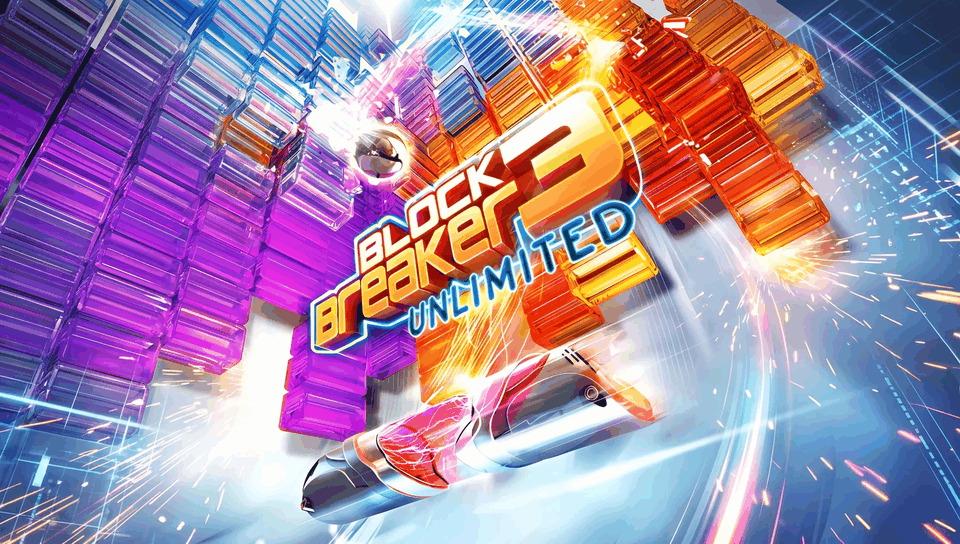

<h1 align="center">
  <br>
  Block Breaker 3 Unlimited · PS Vita Port
</h1>

<p align="center">
  <a href="#-status--playability">Status & Playability</a> •
  <a href="#setup-instructions-for-players">How to install</a> •
  <a href="#controls">Controls</a> •
  <a href="#display-modes--limitations">Display Modes</a> •
  <a href="#known-issues">Known Issues</a> •
  <a href="#build-instructions-for-developers">How to compile</a> •
  <a href="#credits--acknowledgments">Credits</a>
</p>

An unofficial, native **iOS-to-PS Vita wrapper port** of *Block Breaker 3 Unlimited* (originally developed by **Gameloft**). There is no `.so` here: this port ships its own **Mach-O loader** that maps the official iOS ARM executable (`BBD3`, from the 1.6.0 IPA) into PS Vita RAM and replaces the Apple frameworks it uses (Foundation, UIKit, CoreAudio, OpenGL ES) with native implementations on top of **vitaGL**, **zlib** and the Vita system libraries. The executable is stripped, so every hook is placed by address.

---

## 🎮 Status & Playability

**Status: PLAYABLE (v1.0)**

The game boots, reaches the menus, the world map and the levels, and is fully playable on physical PlayStation Vita hardware.

- [x] **Mach-O loader**: loads the iOS ARM executable at a fixed base (`MACHO_SLIDE = 0x98000000`), applies **48,923** rebase words, resolves **8,063** import slots, runs the **314** global constructors and enters the main game loop. *Verified on console.*
- [x] **Graphics**: GLES 1.x → **vitaGL** (compiled with `SOFTFP_ABI=1`). The game renders into its 320×480 portrait framebuffer, which is presented on the Vita's 960×544 screen in one of three display modes (see [Display Modes](#display-modes--limitations)). *Verified on console.*
- [x] **Textures**: the engine's statically linked libpng 1.2 uses its own zlib, which fails on the Vita; its `inflate*` entry points are redirected to the host zlib, so every PNG texture decodes correctly. *Verified on console.*
- [x] **Touch & Controls**: the front touchscreen provides full touch input, mapped to the active display mode. The left stick and D-Pad move the paddle; face buttons launch the ball. *Verified on console.*
- [x] **Audio**: AudioUnit (RemoteIO) is emulated on a dedicated `sceAudioOut` thread; music (`.it` modules) and sound effects play. *Verified on console.*
- [x] **Saves**: progress is written to `ux0:data/blockbreaker3unlimited/saves/` (`bbd3.sav`, `profile.sav`) and loaded on boot (iOS 64-bit-inode `stat` layout emulated).
- [x] **Performance**: CPU at 444 MHz, buffered logger (no SD writes during gameplay), cached lookups for missing bundle files, `-mcpu=cortex-a9 -mfpu=neon`. Targets 60 FPS.
- [x] **Offline bypasses**: in-game ads, App Store and network calls are gracefully stubbed.

---

## Disclaimer

**Block Breaker 3 Unlimited** is a registered trademark of **Gameloft**. The work presented in this repository is unofficial and is not produced, endorsed, or sanctioned by Gameloft or any affiliated entities.

This software does NOT contain original game code, binaries, copyrighted graphics, or game assets. The authors do not promote or condone piracy in any way. To play, you must provide your own legally obtained, **decrypted** copy of the iOS `.ipa`.

---

## Setup Instructions (For Players)

1. **CFW & Plugins**: PS Vita on Custom Firmware (**Enso 3.60 / 3.65** recommended) with `kubridge` under `*KERNEL` in `ur0:tai/config.txt`:
   ```ini
   *KERNEL
   ur0:tai/kubridge.skprx
   ```
2. **Shader Compiler**: `libshacccg.suprx` must be in `ur0:data/` (extract it with **ShaRKBR33D**).
3. **Game Files**: a decrypted **Block Breaker 3 Unlimited 1.6.0** iOS `.ipa` (FairPlay `cryptid 0`). Open it as a ZIP and extract `Payload/BBD3.app/`.
4. **Copy to the Vita** (`ux0:data/blockbreaker3unlimited/`):
   ```
   ux0:data/blockbreaker3unlimited/
     game_app/    the contents of BBD3.app from the IPA, untouched
     rebase.bin   generated from the executable (see "Build Instructions")
     saves/       created automatically — your save games
     logs/        created automatically — log_001.log … log_999.log, one per run
   ```
5. **Install VPK**: install `blockbreaker3unlimited.vpk` with VitaShell.

---

## Controls

| Input | Action | Status |
| :---: | :--- | :---: |
| **Front Touchscreen** | Full touch UI at all times (menus, map, paddle) | ✅ Working |
| **Left Stick / D-Pad ←→** | Move the paddle | ✅ Working |
| **D-Pad ↑ / ↓ (Tate mode)** | Move the paddle right / left (follows the rotated console) | ✅ Working |
| **Cross (✖) / Circle (●) / Square (◼) / Triangle (▲)** | Tap the center of the play area (launch the ball) | ✅ Working |
| **Select** | Cycle display mode | ✅ Working |

---

## Display Modes & Limitations

The game is **portrait (320×480, aspect 1.5)** and the Vita screen is **960×544 (aspect 1.76)**, so the screen cannot be filled without distorting the image. **Select** cycles through three modes:

| Mode | How to hold the console | Image | Borders |
| :--- | :--- | :--- | :--- |
| **Centered** (default) | Landscape | 362×544, original aspect | Black side bars (no fill, no stretch) |
| **Tate** | Rotated 90° clockwise | 816×544 (544×816 seen upright), original aspect | 72 px black bars at the ends (no fill, no stretch, by design) |
| **Fullscreen** | Landscape | 960×544 | None, but the image is **distorted** (almost 3× wider) |

> [!NOTE]
> The black bars in Centered and Tate modes are intentional: filling them would mean stretching or blurring the game image.

---

## Known Issues

- **Saves from builds before v1.0 are lost**: earlier builds could not read the save file and reset it on every boot, so that progress cannot be recovered.
- **Missing `sfx_repulsion.wav`**: the IPA does not ship this sound effect; the game asks for it on some bounces and plays nothing.
- **Online features disabled**: ads, store and networking are bypassed by design.
- **Crash dumps** are written by the system to `ux0:data/` (not to the game folder).

---

## Build Instructions (For Developers)

### Prerequisites

- [VitaSDK](https://vitasdk.org/) (`$VITASDK`) with `vitaGL` (vendored), `vitashark`, `openal-soft`, `freetype`, `libpng` and `zlib`.
- CMake 3.14+, Python 3 (for the tools).
- The decrypted `BBD3.app` folder, linked as `game_app` in the repo root (never committed).

### Compilation Commands

```bash
git clone https://github.com/MetalSyntax/Block-Breaker-3-Unlimited-vita.git
cd Block-Breaker-3-Unlimited-vita
ln -s /path/to/Payload/BBD3.app game_app

# Stage the console data (copies the .app untouched + generates rebase.bin)
tools/stage_data.sh

# Build eboot.bin / blockbreaker3unlimited.vpk
cmake -S . -B build
cmake --build build
```

### Deploy & Debug (over VitaShell FTP)

```bash
python3 -I tools/deploy_data.py          # incremental upload of ux0_data/blockbreaker3unlimited/ (never touches saves/)
python3 -I tools/deploy_data.py --logs   # fetch logs/log_NNN.log and crash dumps into ./logs/
```

A crash PC in `0x98xxxxxx` minus `0x98000000` is the address in the Mach-O: inspect it with `tools/annotate.py game_app/BBD3 <address>`. Architecture and progress notes: [`PORTING_PLAN.md`](PORTING_PLAN.md) and [`port_progress.md`](port_progress.md).

---

## ☕ Support My Work

This project is **free** and will stay free. If you enjoy it, a tip from **$1** helps me keep porting games to the PS Vita:

<p align="center">
  <a href="https://ko-fi.com/metalsyntax"></a>
</p>

- **Ko-fi:** [ko-fi.com/metalsyntax](https://ko-fi.com/metalsyntax)
- **PayPal:** [paypal.me/MetalSyntax](https://paypal.me/MetalSyntax)
- **Bitcoin (BTC):** `133HdCsaWxdjTfmwpgGVykByhNBV338uRc`

**Ko-fi supporters get:**
- **Early access** to new ports before their public release (test builds of upcoming projects).
- **Data preparation scripts and step-by-step guides** to set up your own game files for each new port.
- A say in which games I port next.

> Game files are never distributed. You always need your own legally obtained copy of the game.

---

## Credits & Acknowledgments

- **Block Breaker 3 Unlimited** is intellectual property of **Gameloft**.
- **vitaGL** graphics library by [Rinnegatamante](https://github.com/Rinnegatamante/vitaGL).
- **kubridge** plugin by [Bythos](https://github.com/bythos14/kubridge).
- **OpenAL Soft**, **FreeType**, **libpng** and **zlib** projects.
- The **iOS Mach-O loader** runtime is shared with the [Zombie Infection](https://github.com/MetalSyntax/Zombie-Infection-vita) port and builds on the `ios-loader-boilerplate` work and the Inotia 2 port case study.
- Special thanks to the PS Vita homebrew and porting community.
